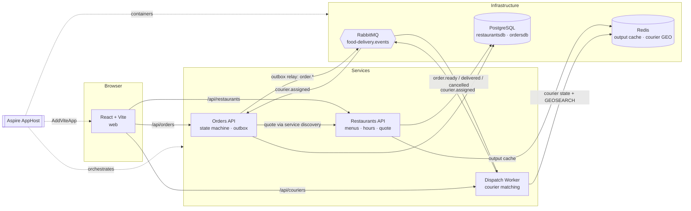
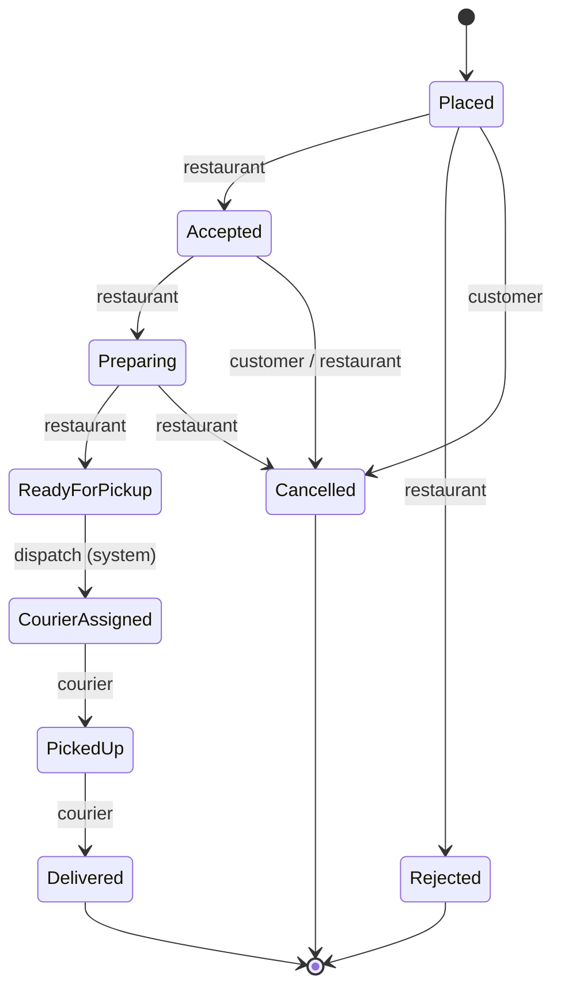

# food-delivery-aspire

**A food delivery platform built as a set of .NET 10 microservices, orchestrated with .NET Aspire.** You can browse restaurants, fill a basket, place an order and follow it live while a dispatch worker assigns the nearest available courier.

[](https://github.com/alexgeorghiou/food-delivery-aspire/actions/workflows/ci.yml)
[](LICENSE)


## Features

- **One-command local environment.** The Aspire AppHost starts PostgreSQL, Redis, RabbitMQ, three .NET services and the Vite dev server. It wires up connection strings and service discovery and shows everything in the Aspire dashboard, with traces, logs and metrics.
- **Restaurants API.** Restaurants, menus and weekly opening hours, stored in EF Core + PostgreSQL. Overnight periods such as Fri 18:00–03:00 are supported, and times are evaluated in each restaurant's own time zone. Menus are served through a **Redis-backed output cache** and evicted per restaurant by tag when an item changes. It also provides a server-side `quote` endpoint, so clients never set prices.
- **Orders API.** Places orders from the authoritative quote and drives an explicit **order status state machine** that checks who is allowed to make each move. A **transactional outbox** reliably publishes `order.placed`, `order.ready`, `order.delivered` and `order.cancelled` to RabbitMQ.
- **Courier Dispatch worker.** Consumes `order.ready` and picks the **nearest available courier by haversine distance**, using tie-breaks and capacity limits. It publishes `courier.assigned` and frees capacity on delivery or cancellation. If no courier is available, the order is retried later. Courier state lives in Redis, and **Redis GEO** (`GEOSEARCH`) pre-filters candidates by radius.
- **Service defaults.** OpenTelemetry tracing, metrics and logs; health and liveness endpoints; service discovery; and standard HTTP resilience (retry, timeout, circuit breaker). W3C trace context travels through AMQP headers, so a single trace shows the whole order → dispatch → assignment flow.
- **React + TypeScript frontend.** A restaurant list with open/closed status and distance, a menu page, a basket with a fee preview, checkout, and an order tracking page that **polls the order status** and includes demo controls for the restaurant and courier steps.
- **Tests.** xUnit tests cover the domain rules (state transitions, dispatch ranking, haversine, opening hours, cart totals) and the service glue (outbox, event serialisation, dispatch orchestration under concurrency).

> Scope note: the platform computes order totals and fees but does **not** handle payments. "You pay the courier on delivery" is shown at checkout.

## Architecture



### Order lifecycle



`ReadyForPickup` raises `order.ready`. The dispatch worker answers with `courier.assigned`, and the Orders API then moves the order to `CourierAssigned`.

## Quickstart

### Prerequisites

- [.NET SDK 10](https://dotnet.microsoft.com/download) (no Aspire workload needed: the AppHost uses the `Aspire.AppHost.Sdk` MSBuild SDK)
- Docker (or Podman) for the PostgreSQL, Redis and RabbitMQ containers
- Node.js 20+ for the web app

### Run everything with Aspire

```bash
cd web && npm install && cd ..
dotnet run --project src/FoodDelivery.AppHost
```

The Aspire dashboard opens with every resource listed. Open the `web` endpoint, choose a restaurant (Night Owl Noodles is open 24/7), place an order, then use the **Demo controls** on the tracking page: Accept → Preparing → Ready. The dispatch worker assigns one of the simulated couriers within a few seconds.

### Run with Docker Compose

```bash
docker compose up --build
# web: http://localhost:8080   RabbitMQ management: http://localhost:15672 (guest/guest)
```

### Build and test

```bash
dotnet build FoodDelivery.slnx
dotnet test FoodDelivery.slnx
```

### Try the APIs directly

```bash
# Couriers known to dispatch (seeded by the dev simulator)
curl http://localhost:5103/couriers

# Send a location ping for a courier
curl -X POST http://localhost:5103/couriers/<id>/location \
     -H "Content-Type: application/json" -d '{"latitude":52.372,"longitude":4.893}'

# Move an order along as the restaurant
curl -X POST http://localhost:5102/orders/<id>/status \
     -H "Content-Type: application/json" -d '{"status":"Accepted","actor":"Restaurant"}'
```

## Project structure

```text
src/
  FoodDelivery.AppHost/          Aspire orchestration (Postgres, Redis, RabbitMQ, services, Vite)
  FoodDelivery.ServiceDefaults/  OpenTelemetry, health checks, service discovery, resilience
  FoodDelivery.Domain/           Pure domain logic, no infrastructure dependencies
    Geo/                         GeoPoint, haversine distance
    Menus/                       Opening hours (overnight periods, time zones, next opening)
    Pricing/                     Cart, pricing policy, fee calculation
    Orders/                      Order aggregate and status state machine
    Dispatch/                    Courier model and nearest-courier matcher
    Events/ Contracts/           Integration events and shared HTTP contracts
  FoodDelivery.Messaging/        RabbitMQ topology, confirmed publisher, consumer base, tracing
  FoodDelivery.Restaurants.Api/  Menus, hours, quotes (EF Core + Npgsql, Redis output cache)
  FoodDelivery.Orders.Api/       Orders, outbox relay, courier-assigned consumer
  FoodDelivery.Dispatch.Worker/  Dispatch consumer, Redis courier store, courier endpoints, simulator
tests/
  FoodDelivery.Domain.Tests/     State machine, dispatch, haversine, opening hours, cart totals
  FoodDelivery.Services.Tests/   Outbox, serialisation, seeded catalogue, dispatch orchestration
web/                             React 18 + TypeScript + Vite frontend
```

## Design decisions and trade-offs

- **Domain logic lives in a plain class library.** The state machine, pricing, opening hours and courier matching have no knowledge of EF, Redis or RabbitMQ, so they can be tested exhaustively and quickly. The services stay thin adapters around them.
- **One table of transition rules.** `OrderStateMachine` holds every legal `(from, to, actor)` triple. The API, the aggregate and the frontend's "next actions" all derive from it, so they cannot drift apart. In this demo the actor comes from the request body. A real deployment would take it from the caller's identity.
- **The server is authoritative on prices.** The Orders API never trusts client prices. It asks the Restaurants API for a quote, which also checks opening hours and item availability, and snapshots the totals onto the order.
- **Transactional outbox over "save then publish".** Events are written in the same transaction as the status change and relayed afterwards with publisher confirms. Delivery is at-least-once, so consumers de-duplicate: Orders records processed message keys, and dispatch re-announces an existing assignment with a deterministic message id.
- **Dispatch ranking.** Couriers are first filtered by availability, fresh location (≤ 5 min), spare capacity and maximum pickup distance. They are then ranked by haversine distance. Everyone within 150 m of the closest courier counts as tied, and ties are broken by fewer active orders, then the longest wait since their last assignment, then id. A tolerance *group* is used instead of distance bucketing so that two couriers 1 m apart never fall into different buckets. Haversine is straight-line distance; a production system would rank on road ETA from a routing engine.
- **Concurrency in dispatch.** Decisions are serialised in-process, so two orders cannot both claim a courier's last slot. This is correct for a single worker replica. Scaling out would need a Redis lock or a Lua script that checks capacity atomically.
- **Output cache with tag eviction.** Menus are cached for 10 minutes and evicted per restaurant on change. The listing includes "open now", so it uses a short 30 s expiry instead of time-based invalidation.
- **`EnsureCreated` instead of migrations.** This keeps the demo self-contained. A long-lived deployment should switch to EF Core migrations, applied by a dedicated migration job.
- **Polling, not push, for tracking.** A 3 s poll that pauses in background tabs is simple and robust behind any proxy. SignalR or SSE would be the next step.

## Roadmap

- SignalR or server-sent events for live order and courier position updates
- Courier-facing app (accept/decline offers, live location sharing)
- Road-network ETAs and batching multiple orders per courier route
- EF Core migrations and a migration worker resource in the AppHost
- Integration tests with `Aspire.Hosting.Testing` against real containers
- Authentication, with restaurant and courier roles mapped to `OrderActor`

## License

[MIT](LICENSE) © 2026 Alex Georghiou
